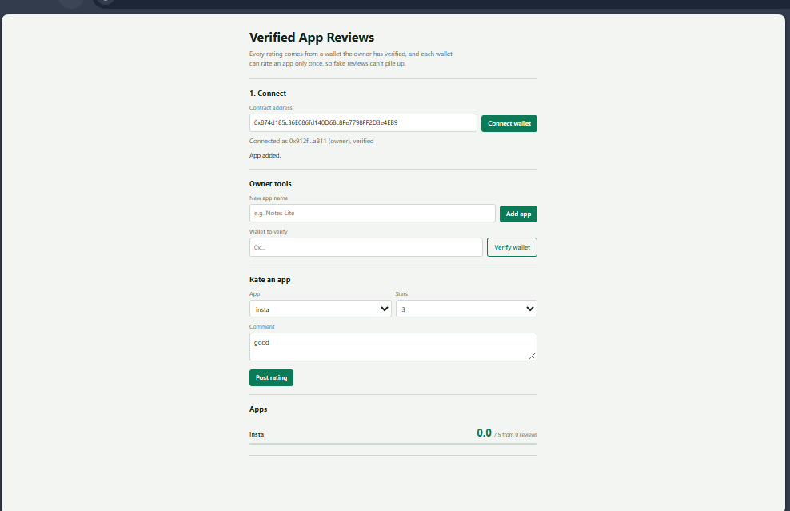
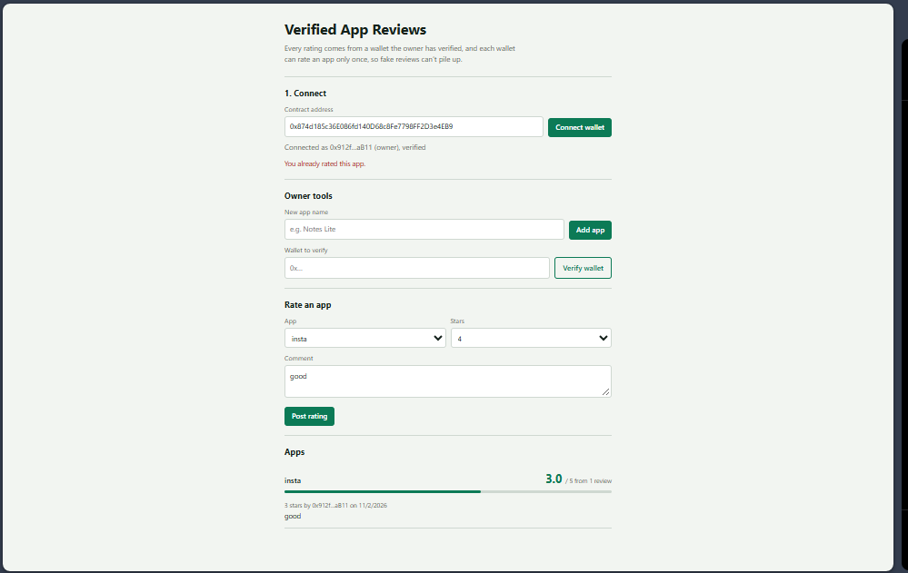

# Verified App Reviews (Decentralized App Review System)

## Project description

A simple decentralized application (DApp) where Android app ratings are stored on the blockchain. Only wallets verified by the contract owner can post a rating, and each wallet can rate a given app only once. This prevents the fake and duplicate reviews common on centralized app stores.

## Features

- Connect a MetaMask wallet from the web page
- Owner can add apps and verify reviewer wallets
- Verified users can rate an app from 1 to 5 stars with a short comment
- One rating per wallet per app, enforced by the smart contract
- Average rating and all reviews are read directly from the blockchain and shown in the UI
- Clear error messages when a transaction is rejected (for example, unverified wallet or duplicate rating)

## Tech stack

- Solidity 0.8.20 (smart contract)
- HTML, CSS and JavaScript (frontend)
- ethers.js v6 (blockchain interaction)
- MetaMask (wallet)
- Sepolia test network

## Repository structure

```
.
├── contracts/
│   └── AppReviews.sol
├── index.html
├── screenshots/
│   └── ui.png
└── README.md
```

## Steps to deploy the smart contract

1. Install MetaMask and switch it to the **Sepolia** test network (enable "Show test networks" in MetaMask settings).
2. Get free Sepolia test ETH from any Sepolia faucet.
3. Open [Remix IDE](https://remix.ethereum.org) and create `AppReviews.sol`, then paste the contents of `contracts/AppReviews.sol`.
4. In the Solidity Compiler tab, select version 0.8.20 or higher and click **Compile**.
5. In the Deploy & Run tab, set Environment to **Injected Provider - MetaMask**, make sure the network is Sepolia, and click **Deploy**.
6. Confirm the transaction in MetaMask and copy the deployed contract address.

## Steps to run the frontend

1. Clone this repository:
   ```
   git clone https://github.com/2Target4U/app-review-dapp.git
   cd app-review-dapp
   ```
2. Open the project folder in **VS Code** (File, then Open Folder).
3. Install the **Live Server** extension (by Ritwick Dey) from the Extensions tab if you don't have it.
4. Right-click `index.html` and choose **Open with Live Server**, or click **Go Live** in the bottom-right corner of VS Code. The page opens at `http://127.0.0.1:5500/index.html`.
5. Open it in a browser that has MetaMask installed, with MetaMask set to the Sepolia network.
6. Paste the contract address into the page and click **Connect wallet**.
7. As the owner, add apps and verify other wallets. Switch to a verified wallet to post ratings.

## Contract address and network

- **Network:** Sepolia testnet
- **Contract address:**  `0x874d185c36E086fd140D68c8Fe7798FF2D3e4EB9`
- **Etherscan:** https://sepolia.etherscan.io/address/0x874d185c36E086fd140D68c8Fe7798FF2D3e4EB9

## Screenshots




## How it works

| Function | Who can call it | What it does |
|---|---|---|
| `addApp(name)` | Owner | Adds an app to the registry |
| `verifyUser(address)` | Owner | Marks a wallet as allowed to review |
| `rateApp(appId, stars, comment)` | Verified wallets | Posts one rating per app |
| `getAverage(appId)` | Anyone | Returns the average rating (multiplied by 100) |
| `getReviews(appId)` | Anyone | Returns all reviews for an app |

## Limitations and future work

- One person can control several wallets, so verification depends on the owner approving wallets carefully. A future version could use a stronger identity check.
- Reviews cannot be edited or deleted once posted.
